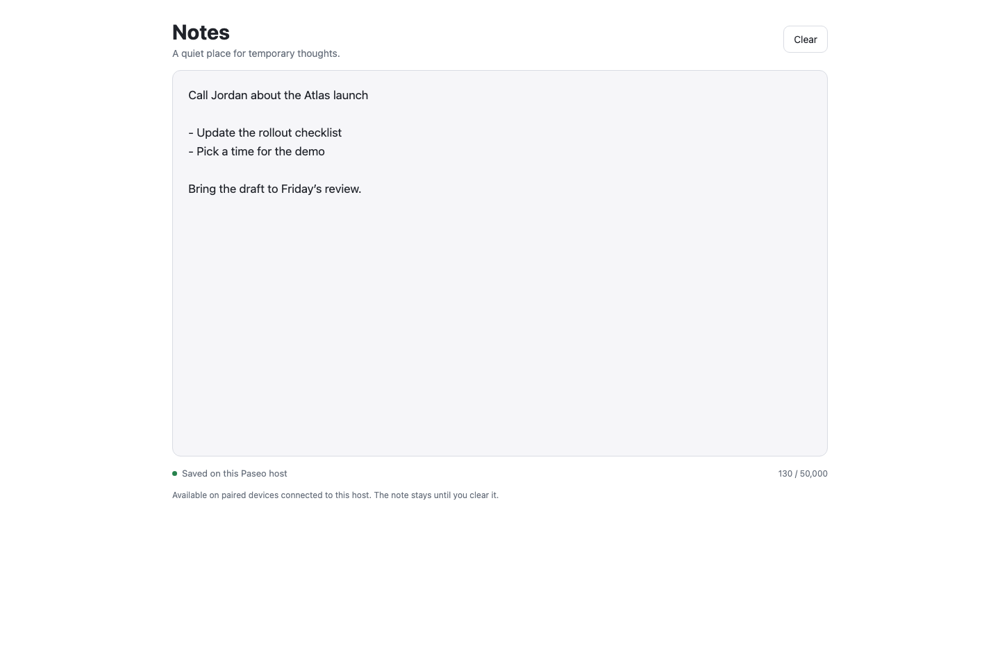
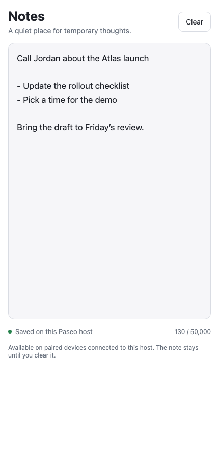

# Notes for Paseo

A small scratchpad for thoughts you want to keep nearby for a little while. Open **Notes** from Paseo's sidebar, type, and the note saves automatically to that Paseo host. Paired devices connected to the same host see the same scratchpad.

## Features

- One plain text scratchpad with automatic saving.
- A clear action when the note is no longer needed.
- Up to 50,000 characters.
- Host-scoped storage; note text stays on the Paseo host and is not sent to an external service.
- Works on desktop, web, iOS and Android clients.

## Requirements

- Paseo 0.16.1 or newer.
- Plugins enabled on the host.

## Install

```bash
paseo plugin install npm:@kevlai22/paseo-notes@0.1.0
```

Then open **Notes** from the Paseo sidebar. To update, install the new version with Paseo's plugin update controls or remove and reinstall the plugin.

For a local checkout:

```bash
paseo plugin install /absolute/path/to/paseo-notes
```

## Data and privacy

The scratchpad is stored in Paseo's host-scoped plugin settings and remains there until cleared. It is shared by clients connected to that host. Clearing removes the saved text. The plugin does not access workspace files, databases, receipts, or network services.

## Screenshots

Synthetic examples using fictional Atlas notes:





## License

MIT. See [LICENSE](LICENSE).
